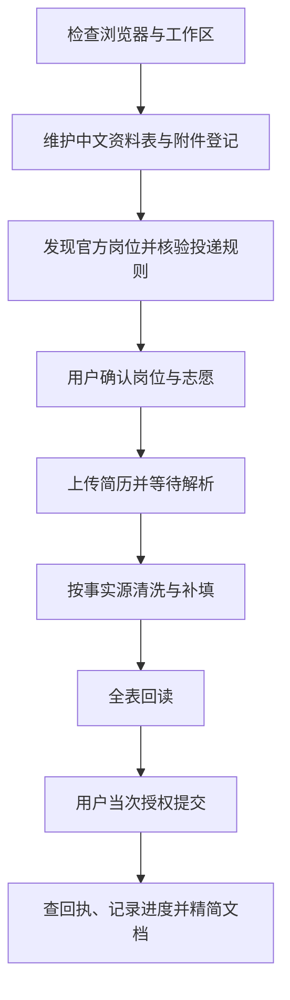

<p align="center">
  
</p>

<h1 align="center">Job Application Workflow</h1>
<p align="center"><strong>维护一份中文资料，串起岗位调研、网申填写和进度跟进。</strong></p>

<p align="center">
  <a href="https://github.com/chienchen-png/job-application-workflow/releases"></a>
  
  
  
  
  <a href="LICENSE"></a>
</p>

<p align="center">
  <a href="#agent-install">交给智能体部署</a> ·
  <a href="#features">核心特点</a> ·
  <a href="#workflow">工作流程</a> ·
  <a href="#quickstart">开始使用</a> ·
  <a href="#verification">验证与边界</a> ·
  <a href="https://github.com/chienchen-png/job-application-workflow/issues">问题反馈</a>
</p>

## 📖 这是什么？

**Job Application Workflow** 是面向实习、校招及其他在线申请场景的 Codex 插件。你维护一份中文 Markdown 资料和附件清单，智能体据此寻找官方岗位、分析投递限制、填写并核验申请，最后记录进度。

> 把反复问个人信息、找附件、查规则、改解析结果的工作，整理成 **“准备资料 → 确认岗位 → 填写核验 → 跟进结果”** 的可复用流程。

**中文表单 · 唯一事实源 · Edge Control 专用 · 提交由你确认 · GitHub 开源分发。** 浏览器只通过 Edge Control 桥接及配套 Skill 操作你现有的 Edge，依赖需单独配置。

<a id="agent-install"></a>

## 🚀 交给智能体部署

打开本机 Codex，新建对话，复制下面整段提示词发送。智能体会检查环境并配置插件；不需要你先学会修改配置文件。

```text
请帮我在本机 Codex 安装并使用 Job Application Workflow。
官方仓库：https://github.com/chienchen-png/job-application-workflow

请实际执行可完成的步骤，用适合非技术用户的中文说明进度：

1. 检查系统、Git、Codex 版本与可用工具，读取仓库 README.md、plugin.json
   和 skills/环境配置/SKILL.md，以当前代码和官方安装文档为准。
2. 获取完整仓库，保留 skills、模板、脚本和 assets。
   已有目录先检查 Git 状态，不覆盖用户修改，不重复克隆或只复制单个 Skill。
3. 使用当前客户端支持的安装方式。CLI 可用时先检查：
   codex plugin marketplace add --help
   支持该命令时添加市场：
   codex plugin marketplace add chienchen-png/job-application-workflow
   否则按官方文档配置本地或个人市场；只合并本插件条目并备份原配置，
   不覆盖其他插件。不要把“添加市场”当成“插件已安装”。
4. 继续完成安装和启用。市场来源：job-application-workflow-local；
   插件名：job-application-workflow。
   若必须由我点击安装或重启，告知准确位置和下一步，不提前宣布成功。
5. 在新会话验证四个技能：job-setup、job-profile、job-research、job-apply。
   读取 skills/环境配置/references/Edge配置.md，配置第三方
   C4AL/codex-edge-control-bridge 的 Edge Control MCP、bridge、Edge 扩展及
   edge-browser-ops Skill；已有可用组件不重复安装，先说明上游归档情况。
   先查 edge_bridge_status 和 edge_list_tabs，使用我现有 Edge 主窗口及会话。
   检查 DOM 读取、填写、回读和本地附件上传；缺项逐步指导，未验证如实说明。
   禁止用 Codex 内置浏览器、Computer Use、cua_repl 或其他浏览器工具替代。
   桥接未就绪时暂停浏览器步骤，保留资料工作；不默认安装 Python。
6. 让我选择插件目录以外的私有求职工作区，创建缺失的中文空白资料表。
   指明先编辑哪份 Markdown、附件放哪里、如何用编号关联经历与附件，
   然后带我完成一次岗位调研与提交前填写。
7. 保留已有资料，不读取原始简历或附件正文，不把个人资料提交到 GitHub。
   验证码、隐私授权和正式测评交给我，最终网申提交需我当次明确授权。
   不申请官方插件商店上架。
8. 最后简短告知：安装位置、如何再次使用、资料位置、验证结果，
   以及仍需我完成的操作。不要只返回安装教程。
```

本仓库的本地市场来源为 `job-application-workflow-local`，插件名为 `job-application-workflow`。一句话启动不代表所有机器都能无人值守安装；浏览器权限、客户端安装按钮或重启可能需要你操作。不要向智能体提供账号密码或验证码。安装方式依据[官方本地市场说明](https://developers.openai.com/plugins/build/plugins)。

<a id="features"></a>

## ✨ 核心特点：解决哪些痛点

申请多家公司时，耗时的不只是输入文字：相同经历被反复询问，不同简历版本相互冲突，附件路径难找，志愿次数容易误判，自动解析又会把公司、日期和职责拼错。填写完成后，冗长的执行文档还可能掩盖真正的投递进度。

本项目把准备工作前置，将可复用的事实与每次申请的页面要求分开管理：先维护资料，再研究规则，最后执行并核验。

| 常见痛点 | 本项目的处理 | 带来的价值 |
|---|---|---|
| 每次对话都重新描述经历 | 一份中文 Markdown 空白表单，用户持续维护 | 下一家公司复用已有事实，减少零散问答 |
| 中英文简历、聊天记忆各有一套答案 | 唯一事实源，翻译与改写引用同一条记录 | 减少数字、日期和身份信息漂移 |
| 实习、证书和附件对应关系混乱 | 记录编号关联附件编号，路径只登记一次 | 换路径时不用修改所有经历 |
| 多城市、多志愿与投递次数不清 | 先核验项目、岗位和账号三个层面的限制 | 避免把多个志愿误当成多次申请 |
| 上传后自动解析结果出错 | 先上传、等解析，再逐字段清洗并回读 | 不把解析成功误当成资料正确 |
| 填写、上传、保存和提交混在一起 | 独立记录申请阶段、测评阶段和证据来源 | 清楚知道完成了什么、下一步是什么 |
| 过程报告越积越长 | 填写期保留必要映射，提交后收敛为结果记录 | 日常只看总览、公司页和申请单 |

这里的特点是**流程组合与约束设计**：把“事实维护—规则发现—执行核验—状态收尾”连起来。我们不宣称这些单项方法是行业首创，也没有未经测量的效率倍数、成本下降或录取率数据。

<a id="workflow"></a>

## 🔄 工作流程



| 中文 Skill | 调用名称 | 主要产物 |
|---|---|---|
| 环境配置 | `$job-setup` | 可用能力、缺项和配置步骤 |
| 资料管理 | `$job-profile` | 唯一事实源、求职意向、附件关联 |
| 岗位调研 | `$job-research` | 官方链接、少量候选、推荐理由和未知条件 |
| 网申执行 | `$job-apply` | 经回读的申请及有来源的进度记录 |

四个技能可单独使用。它们提供工作方法；页面执行能力由下述独立 Edge Control 依赖提供，本项目不捆绑第三方扩展、MCP 源码或本地 token。

## 🌐 浏览器组件：仅使用 Edge Control

明确指定 [C4AL/codex-edge-control-bridge](https://github.com/C4AL/codex-edge-control-bridge) 与其 **`edge-browser-ops` Skill**，而非“任意能操作 Edge 的工具”。链路为：

```text
求职工作流 Skill → edge-browser-ops → edge-control MCP
                 → 本机 bridge → 用户 Edge 扩展 → DOM / CDP
```

| 组件 | 如何接入 |
|---|---|
| 求职插件四个 Skill | 本仓库提供；环境配置、岗位调研和网申执行均显式约束工具路径 |
| `edge-browser-ops` Skill | 从上游部署，不在此复制维护；执行前读取已安装版本 |
| `edge-control` MCP、本地 bridge、Edge 扩展 | 独立部署到本机；先检查状态与标签页，再操作当前会话 |
| Codex 内置浏览器、Computer Use、cua_repl 等 | 不用于本项目浏览器执行；缺少桥接时不能作为回退方案 |

只用用户现有 Edge 主窗口和配置文件，不新建自动化 profile。DOM/CDP 操作减少对屏幕焦点和截图推断的依赖；登录、验证码、授权仍由用户在真实浏览器处理，需要时将准确标签页交给用户。

**依赖状态（2026-11-16）：上游仓库已归档，最新 Release 为 v0.1.7，后续维护无保证。** 当前配置路径针对 Windows + Edge + Node.js + PowerShell，其他系统未验证。首次部署从上游 Release 获取快速部署包并核验校验和，审阅后执行 `scripts/quick-deploy.ps1`，再由用户在 `edge://extensions` 加载其 `extension/`。MCP、Skill、扩展三者可用且完成实际操作验证后才算就绪。具体步骤及恢复方式见 [Edge配置](skills/环境配置/references/Edge配置.md)。

这属于**已明确的依赖与配置流程**，不代表本仓库已内置或已替使用者安装了组件。桥接不可用时继续整理资料，暂停网页操作；不套用其他 ChatGPT 浏览器扩展的权限设置来修复此桥接。

<a id="quickstart"></a>

## 🧭 开始使用

### 1. 安装与环境

当前通过 **GitHub 开源分发，不申请官方商店上架**。建议直接使用上方安装提示词；手动安装也可先克隆仓库，完整保留其目录，不要只复制某个 Skill。

```sh
git clone https://github.com/chienchen-png/job-application-workflow.git
```

项目已附 `.agents/plugins/marketplace.json`：以本项目目录为仓库根目录打开受信任项目，在支持本地市场的客户端中重新加载或重启，查看来源“Job Application Workflow · 本地”，安装 `job-application-workflow`。这不会加入全局公共商店，也不会替用户自动修改全局配置。安装后新会话确认四个技能可见；**这条安装路径已按官方格式配置，尚未完成干净客户端实测。** [官方本地市场说明](https://developers.openai.com/plugins/build/plugins)

若尚不安装插件，可以让 Codex 直接读取对应 `skills/中文目录/SKILL.md`，连同共享模板执行；这是手动使用方式，不等于插件已安装或已被搜索收录。

浏览器依赖按上方 Edge Control 链路检查与配置；资料检查脚本需要 Node.js 18+，桥接运行时须另按上游依赖确认兼容。人工维护资料不需要 Node，整个插件不要求 Python。认证和用户接管时不保证完全不占焦点。

### 2. 建立你的资料库

指定一个插件目录以外的私有工作区，然后发送：

> 使用求职投递，检查环境并初始化这个工作区。已有资料先检查，不要覆盖。

AI 创建缺失的工作区文件，你直接填写 [个人资料模板](模板/个人资料.md) 和 [求职意向模板](模板/求职意向.md)。资料表预置教育、经历、科研、项目、技能语言、证书奖项、实习安排、声明和公司补充，值全部为空。

空白表示未知，不能默认成“无”“否”或“不适用”；条件性敏感字段官网要求时再填。复制经历小节即可增加记录。声明需注明适用范围与确认日期，不把某家公司答案套给所有公司。

例如：一段经历编号为 `实习-001`，其“关联附件”填 `附件-001`；末尾附件登记表才填写 `01_附件库/经历证明/证明.pdf`。路径只维护一处，AI 不读取附件正文来补写个人事实。

### 3. 选岗与执行

> 按我的资料和意向，寻找目标公司的官方招聘入口，分析岗位、城市和投递限制，只给简洁建议。

确定后再发送：

> 按确认的岗位和志愿填写网申，先上传简历并清洗解析内容，完成后回读，停在提交前。

人数、薪资和截止日期只记录有来源的信息；未公开就写未公开，不虚构录取概率。提交要有当次授权；登录、验证码、隐私确认与正式招聘测评需要用户参与。

## 📁 数据与目录

```text
用户工作区/                 插件之外，私人维护
├── AGENTS.md               统一工作约定
├── 00_基础资料/            个人资料.md、求职意向.md
├── 01_附件库/              文件实体，按编号关联
├── 02_公司/
│   └── 公司名/             公司总览.md、APP-0001.md
└── 90_投递总览.md          状态、来源和下一步
```

事实只维护在个人资料中；表单映射是临时结果。状态可以来自用户明确确认或官网回执，分别标来源；确认日期不冒充实际提交日期，测评完成不代表通过。完整行为约束集中在 [工作约定模板](模板/工作约定.md)。

## 📦 分发方式

本项目只维护 GitHub 仓库与本地市场安装，不推进官方账号上传或公共商店审核。添加本地市场后，可在该来源中安装使用；这不代表被官方公共目录收录，也不需要为此完成官方发布者身份验证。

<a id="verification"></a>

## 🧪 验证与使用边界

```powershell
node "<插件目录>/脚本/检查资料.mjs" "<用户工作区>"
node "<插件目录>/脚本/检查资料.mjs" "<用户工作区>" --最大字节=524288
node --test "<插件目录>/脚本/检查资料.test.mjs"
```

检查章节、未填字段、重复编号、附件引用、日期、路径和可选大小限制；只读 Markdown 及附件元数据，不改资料、不读附件正文、不生成报告。退出码 0 表示未发现问题，1 为有问题，2 为调用或环境错误。最大字节参数作用于全部登记附件；官网不同字段的不同限制仍需逐项核验。未填项不自动等于本次申请必填项。

验收记录（2026-11-16）：

- 已通过：插件清单基础 Schema、四个 Skill 格式、6 项资料校验测试。
- 历史测试：此前通过另一套工具完成过 DOM 填写、模拟解析清洗与回读；不计入 v0.2.0 指定 Edge Control 链路的验收，其扩展上传权限问题也不作为本桥接的故障结论。
- 待验证：Edge Control 状态/标签页、填写回读、附件上传全链路，干净客户端安装发现及真实招聘网站适配。当前会话未暴露该桥接的 `edge_*` 工具，未安装或变更本机组件，不声称组件已配置成功。

它适合愿意维护个人资料、希望在关键节点确认的求职者；需要无人值守批量提交、绕过验证或代做招聘测评的场景不在项目范围内。收益来自减少重复整理和提高可核验性，不保证任何网站都能自动填写。

## 🤝 贡献与许可证

欢迎贡献匿名的字段类型、平台差异和可复现问题。提交问题时提供系统/客户端版本、脱敏操作步骤、预期和实际结果；不要提交身份证件、真实简历、联系方式、Cookie 或完整私有申请链接。改脚本请运行测试，改 Skill 请检查相对引用与事实约束。

开源只发布本目录的新建独立 Git 历史，不能公开父级私人求职仓库及其历史。`.gitignore` 仅为补充防护。采用 [MIT](LICENSE) 许可证。

文档组织参考 [anthropics/skills](https://github.com/anthropics/skills) 的能力与使用边界说明，以及 [obra/superpowers](https://github.com/obra/superpowers) 的工作流与分发路径组织；不代表获得这些项目或 OpenAI 的背书。
