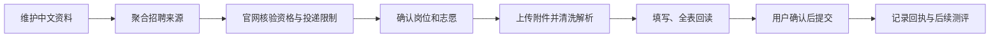

<p align="center">
  
</p>

<h1 align="center">Job Application Workflow</h1>
<p align="center"><strong>把复杂的求职投递流程整合为一个 Codex 插件。</strong></p>

<p align="center">
  <a href="https://github.com/chienchen-png/job-application-workflow/releases"></a>
  
  
  
  
  <a href="LICENSE"></a>
</p>

<p align="center">
  <a href="#start">快速开始</a> ·
  <a href="#workflow">工作流</a> ·
  <a href="#sources">招聘来源</a> ·
  <a href="#edge">浏览器方案</a> ·
  <a href="#structure">项目结构</a> ·
  <a href="#development">参与开发</a>
</p>

## 一个插件，覆盖完整投递流程

Job Application Workflow 将求职准备拆成资料、调研、网申和状态跟踪四个阶段，再整合为一个 Codex 插件：

```text
中文资料库 → 岗位调研 → 网申填写与回读 → 投递记录
```

用户只需持续维护一份 Markdown 资料。智能体据此聚合招聘来源、匹配资格、核验官方规则、填写表单、清洗简历解析结果，并记录申请状态。

项目的四项特点：

- **流程整合**：资料、附件、岗位、申请和测评记录进入同一工作流，减少重复问答与多处台账。
- **唯一事实源**：经历、资格、技能和附件统一编号，所有申请复用同一份个人资料。
- **Edge 扩展直连**：通过 DOM 与 CDP 操作用户现有 Edge，不切换桌面焦点，可继续处理其他窗口。
- **Windows 原生部署**：插件、Edge 扩展、本地 bridge 与 PowerShell 配置脚本可直接在 Windows 使用。

## 四个 Skill

| Skill | 用途 | 主要产物 |
|---|---|---|
| `$job-setup` | 检查工作区、安装并验证 Edge Control | 可用环境与配置结果 |
| `$job-profile` | 建立和维护个人资料、意向与附件索引 | 中文事实源 |
| `$job-research` | 聚合招聘来源，核验岗位与投递规则 | 公司总览与岗位建议 |
| `$job-apply` | 上传附件、填报、清洗解析、回读和记录 | APP 申请记录 |

四个 Skill 可独立调用，共享同一套工作约定和中文模板。

<a id="sources"></a>

## 招聘来源

插件内置 [招聘来源注册表](数据源/招聘来源.json)，首轮覆盖：

- 德勤、安永、毕马威、普华永道官方网申页。
- 西南财经大学就业网、招聘列表与“西财就业”公众号。
- BOSS直聘。
- 中信证券、中信建投、中金公司、华泰证券。
- 麦肯锡、BCG、贝恩、埃森哲。
- Microsoft、Amazon、Google、Apple。
- Greenhouse、Lever、Ashby、SmartRecruiters 公开 ATS。

智能体从注册表取得公司入口和访问方式；公开 ATS 由本地脚本统一读取：

```powershell
node ".\脚本\招聘来源.mjs" entries 金融 --query=审计 --city=成都
node ".\脚本\招聘来源.mjs" ats ashby openai --query=finance --location=China
```

<a id="edge"></a>

## 浏览器核心：Edge 扩展直连

浏览器链路固定为：

```text
求职 Skill
  → edge-browser-ops
  → edge-control MCP
  → 本地 bridge
  → Edge 扩展
  → 用户现有 Edge 标签页
```

`edge-control` 提供 22 个 MCP 工具，覆盖标签页、导航、DOM 查询、点击、输入、页面脚本、CDP、批量抓取和附件文件注入。整个过程默认调用后台标签页与 DOM/CDP，不依赖截图或桌面鼠标，因此不会持续抢占 Windows 屏幕焦点。

浏览器操作入口仅为上述 Edge 扩展链路。脚本沿用用户现有 Edge 配置与登录会话，可跨多个申请复用标签页和进度；Codex 内置浏览器、Computer Use 与桌面截图不参与执行。

环境配置 Skill 已写明 MCP 来源、命令、环境变量、端点、配置位置、工具清单、安装与验证步骤；插件同时提供可重复执行的配置脚本：

```powershell
powershell -ExecutionPolicy Bypass -File ".\脚本\配置Edge控制.ps1"
```

脚本下载并校验 Edge Control `v0.1.7`，启动隐藏的本地 bridge，注册 `edge-control` MCP，安装 `edge-browser-ops` Skill。首次使用时，在 `edge://extensions` 加载脚本输出的 `extension` 目录即可。

<a id="start"></a>

## 快速开始

### 交给智能体安装

在 Codex 中发送：

```text
请从 https://github.com/chienchen-png/job-application-workflow 安装并启用
Job Application Workflow，然后使用 $job-setup 完成 Edge Control、edge-browser-ops、
Edge 扩展和私人工作区配置。仅在 Edge Control 缺失或修复时读取 Edge配置.md。
验证后在插件目录外初始化私人求职工作区，并交接 $job-research 完成第一次岗位调研。
```

智能体会安装插件、检查已有环境、执行缺失步骤，并输出仍在等待用户操作的准确入口。

### 手动安装

```powershell
git clone https://github.com/chienchen-png/job-application-workflow.git
cd job-application-workflow
codex plugin marketplace add .
codex plugin add job-application-workflow --marketplace job-application-workflow-local
```

初始化私人工作区：

```powershell
powershell -ExecutionPolicy Bypass -File ".\脚本\初始化工作区.ps1" -Workspace "D:\求职工作区"
```

安装后在新的 Codex 会话中调用：

```text
使用 $job-setup 检查并配置求职环境
使用 $job-profile 初始化我的中文资料库
使用 $job-research 聚合来源并调研目标公司的岗位
使用 $job-apply 填写已确认的申请并停在提交前
```

<a id="workflow"></a>

## 工作流



资料阶段只维护 `00_基础资料/个人资料.md`；岗位阶段形成简洁的公司总览；网申阶段为每份申请表建立一个 `APP-*.md`；提交后收敛为结果记录。填写映射、页面快照等过程材料进入 `_AI内部/`，阶段结束后清理。

<a id="structure"></a>

## 项目结构

```text
job-application-workflow/
├── plugin.json                 Codex 插件清单
├── 数据源/招聘来源.json         公司与平台来源注册表
├── skills/
│   ├── 环境配置/               Edge Control 与工作区配置
│   ├── 资料管理/               事实源与附件索引
│   ├── 岗位调研/               多来源岗位发现与研究
│   └── 网申执行/               表单填写与申请记录
├── 模板/                       用户工作区空白模板
├── 脚本/                       资料检查、招聘来源与 Edge 配置
└── assets/                     插件图标
```

个人求职工作区位于插件目录之外，不进入 Git：

```text
用户工作区/
├── AGENTS.md
├── 00_基础资料/
├── 01_附件库/
├── 02_公司/
├── _AI内部/
└── 90_投递总览.md
```

<a id="development"></a>

## 开发与验证

检查资料工作区：

```powershell
node ".\脚本\检查资料.mjs" "<用户工作区>"
```

运行测试：

```powershell
node --test ".\脚本\检查资料.test.mjs"
node --test ".\脚本\招聘来源.test.mjs"
node --test ".\脚本\初始化工作区.test.mjs"
powershell -ExecutionPolicy Bypass -File ".\脚本\配置Edge控制.ps1" -ValidateOnly
```

提交改动时运行以上命令，并确认四个 `SKILL.md` 的 frontmatter 与相对引用有效。

## 参与开发

项目采用 Issue → Fork → Pull Request → 代码所有者审核 → Squash Merge 的协作流程。`main` 分支通过 Pull Request 合并，外部贡献无需协作者权限。

贡献集中到现有四个 Skill、共享模板和脚本：

- 新能力优先进入最匹配的现有 Skill。
- 只有形成独立、长期复用的新阶段时才新增 Skill。
- 新招聘来源同步更新 `数据源/招聘来源.json`、适配方法与测试。
- 浏览器链路保持 `edge-browser-ops → edge-control MCP → bridge → Edge 扩展`。
- 个人资料、附件、账号信息和真实申请记录只保存在用户私有工作区。

具体范围、代码要求和验证命令见 [CONTRIBUTING.md](CONTRIBUTING.md)。提交 PR 前运行：

```powershell
node --test ".\脚本\检查资料.test.mjs"
node --test ".\脚本\招聘来源.test.mjs"
node --test ".\脚本\初始化工作区.test.mjs"
powershell -ExecutionPolicy Bypass -File ".\脚本\配置Edge控制.ps1" -ValidateOnly
```

项目采用 [MIT License](LICENSE)。
